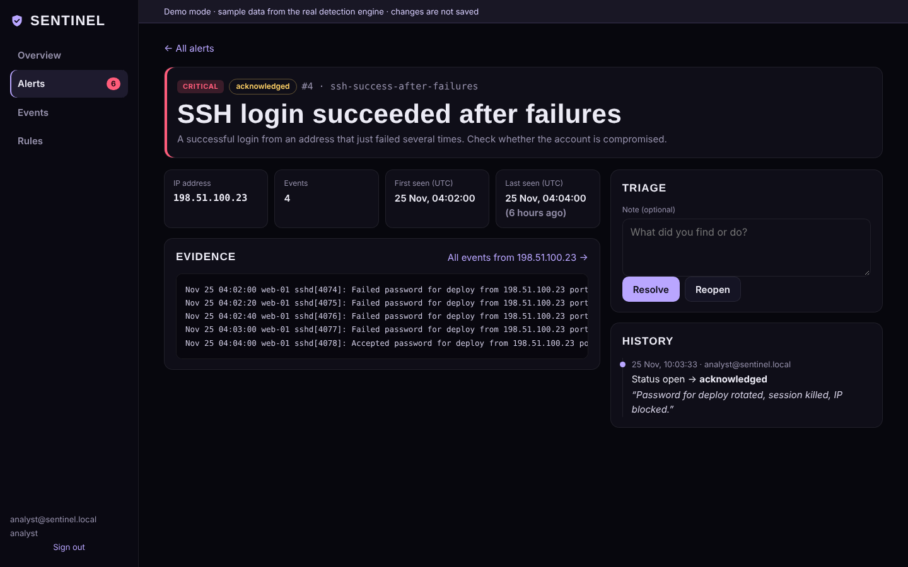
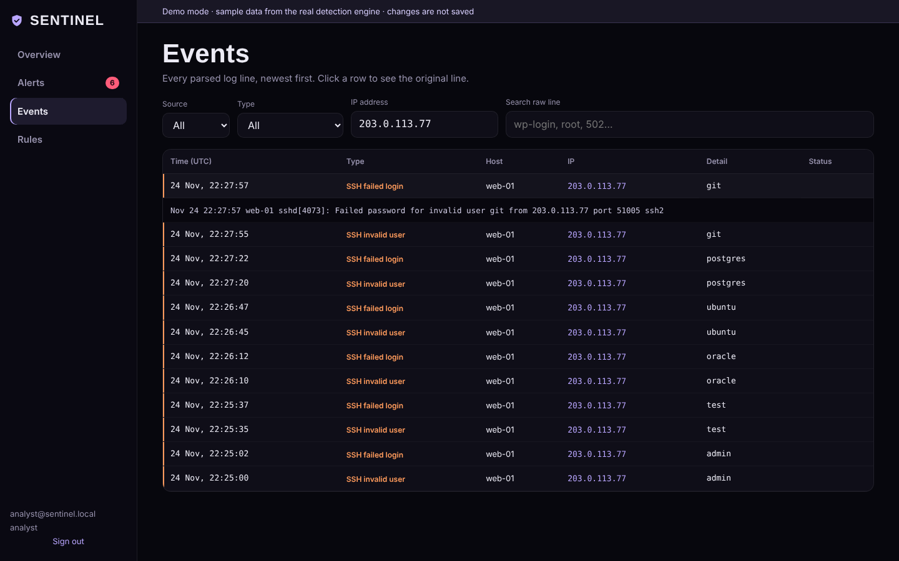
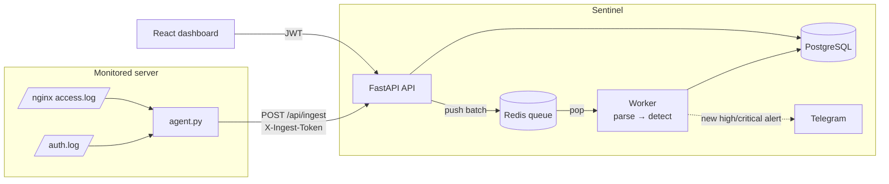

# Sentinel

🇷🇺 [Русская версия ниже](#ru)

**Self-hosted security monitoring for small servers.** A lightweight agent ships SSH, sudo and nginx logs to a FastAPI backend; a detection engine turns them into alerts that analysts triage from a React dashboard, with optional Telegram notifications.

**Live demo:** https://dav1dushka.github.io/sentinel/ (static build, sample data run through the real detection engine; any email signs you in)


## What it does

- **Collects logs:** a dependency-free Python agent follows `/var/log/auth.log` and nginx access logs, survives log rotation and retries with backoff when the API is down.
- **Detects attacks** with rules written in YAML: SSH brute force, password spraying, username probing, *a successful login right after failures*, risky `sudo` commands, web scanners, requests for `.env` / `.git`, and spikes of 5xx errors.
- **Manages alerts:** severity, evidence (the exact log lines), acknowledge / resolve / reopen, notes, assignee and a full audit history.
- **Explores events:** filter by source, type and IP, search raw lines, cursor pagination.
- **Notifies:** new high and critical alerts go to Telegram (optional).

| Alert with evidence and triage history | Events filtered by IP |
| --- | --- |
|  |  |

## Architecture



- **Ingestion is asynchronous.** The API only validates and queues a batch, so a flood of log lines never slows the dashboard down. One worker owns the detection state (sliding time windows), which keeps the results deterministic.
- **The detection core is pure Python** (`backend/sentinel/core/`): no I/O, no framework, no database. That makes it easy to unit-test and to replay old logs: time comes from the events, not the wall clock.
- **Alerts are grouped.** A rule that keeps firing for the same key updates the open alert instead of creating hundreds of new ones.

## Quick start (Docker)

```bash
git clone https://github.com/Dav1dushka/sentinel && cd sentinel
cp .env.example .env            # then change every value marked CHANGE ME
docker compose up --build
```

- Dashboard: http://localhost:8080, sign in with `SENTINEL_ADMIN_EMAIL` / `SENTINEL_ADMIN_PASSWORD` from `.env`
- API docs (OpenAPI): http://localhost:8000/docs
- The `seed` service loads a day of sample logs so the dashboard is not empty.

Want to watch it work live? Start the demo profile: a fake server writes normal traffic with an attack every minute, and a real agent ships it.

```bash
docker compose --profile demo up --build
```

## Monitor a real server

Copy `agent/agent.py` to the server (Python 3.9+, standard library only):

```bash
export SENTINEL_INGEST_TOKEN=...   # same value as in Sentinel's .env
sudo -E python3 agent.py --url https://sentinel.example.com \
     --file auth:/var/log/auth.log --file nginx:/var/log/nginx/access.log
```

## Detection rules

Rules live in [`backend/rules/default.yml`](backend/rules/default.yml), so changes are reviewed like code:

```yaml
- id: ssh-success-after-failures
  title: SSH login succeeded after failures
  severity: critical
  type: sequence
  match: {kind: ssh_failed}      # at least 3 of these…
  then: {kind: ssh_success}      # …followed by this, from the same IP
  group_by: ip
  threshold: 3
  window: 600                    # seconds
```

Conditions support equality, `in`, `regex`, `not` and numeric comparisons (`gt`, `gte`, `lt`, `lte`). `distinct: user` counts different values instead of events, which is how password spraying is caught. Invalid rules fail at startup with a message that names the rule.

## API

| Method | Path | Who | Purpose |
| --- | --- | --- | --- |
| POST | `/api/auth/login` | anyone | OAuth2 password form → JWT (rate-limited) |
| GET | `/api/auth/me` | user | current user |
| POST | `/api/ingest` | agent token | queue up to 5,000 log lines |
| GET | `/api/events` | user | filter by source, kind, ip, text; cursor pagination |
| GET | `/api/alerts` | user | filter by status, severity, text |
| GET / PATCH | `/api/alerts/{id}` | user | details; change status, add a note, assign to me |
| GET | `/api/stats/overview?hours=24` | user | counters, hourly timeline, top offenders, top rules |
| GET | `/api/rules` | user | loaded detection rules |
| GET / POST | `/api/users` | admin | list and create users |
| GET | `/api/health` | anyone | database, queue and rules status |

## Security decisions

- Passwords hashed with **scrypt** (salted, memory-hard), compared in constant time.
- Short-lived **JWT** access tokens with issuer, expiry and role checks; tokens with `alg: none` or unknown roles are rejected.
- **Roles:** analysts triage alerts, admins also manage users.
- **Login rate limiting:** 8 failed attempts per client per 5 minutes, then HTTP 429.
- Agents authenticate with a separate **ingest token**, compared in constant time; batches and line lengths are capped.
- The dashboard is served by nginx with a strict **Content-Security-Policy** and security headers; the API container runs as a non-root user.
- The app logs a warning when it starts with development secrets.

## Development

```bash
# backend
cd backend
python -m venv .venv && source .venv/bin/activate
pip install -r requirements-dev.txt
pytest -q                          # parsers, rules, engine, security and full API flow
uvicorn sentinel.main:app --reload # SQLite + inline processing, no Docker needed

# frontend (proxies /api to :8000)
cd frontend && npm install && npm run dev
npm run build:demo                 # static demo build with sample data
```

The sample logs are generated by `backend/samples/generate.py` (fixed seed, documentation-only IP ranges from RFC 5737). The tests check that each attack hidden in them produces exactly one alert and that normal traffic produces none.

CI (GitHub Actions) runs ruff and pytest, builds the dashboard and both Docker images; a second workflow publishes the demo to GitHub Pages.

## Project layout

```
agent/            log shipper and demo traffic generator (standard library only)
backend/
  sentinel/core/  parsers, rule loader, detection engine (pure Python)
  sentinel/       FastAPI app, models, pipeline, Redis worker, Telegram notifier
  rules/          detection rules (YAML)
  samples/        synthetic auth and nginx logs
  tests/          pytest suite
frontend/         React + TypeScript dashboard (Vite), SVG charts, demo mode
docker-compose.yml
```

## Roadmap

- Rule editor in the dashboard with a dry run against recent events
- More sources: journald, Windows Security log, Docker container logs
- GeoIP enrichment and an allow-list for known addresses
- Alembic migrations and per-host agent tokens

## License

MIT. Built by [Davyd Velychko](https://github.com/Dav1dushka).

---

<a id="ru"></a>

# Sentinel — по-русски

**Мониторинг безопасности для небольших серверов, который разворачиваешь у себя.** Лёгкий агент отправляет логи SSH, sudo и nginx в бэкенд на FastAPI. Движок обнаружения превращает их в алерты, которые аналитики разбирают в дашборде на React. Уведомления в Telegram — по желанию.

**Демо:** https://dav1dushka.github.io/sentinel/ (статическая сборка: тестовые логи прогнаны через настоящий движок обнаружения; войти можно с любым email)

## Что умеет

- **Собирает логи:** агент на Python без зависимостей следит за `/var/log/auth.log` и access-логами nginx, переживает ротацию логов и повторяет отправку с нарастающей паузой, если API недоступен.
- **Находит атаки** по правилам на YAML: перебор паролей SSH, password spraying, подбор имён пользователей, *успешный вход сразу после серии неудач*, опасные команды `sudo`, веб-сканеры, запросы к `.env` / `.git` и всплески ошибок 5xx.
- **Ведёт алерты:** уровень опасности, доказательства (точные строки лога), подтвердить / закрыть / открыть снова, заметки, ответственный и полная история действий.
- **Показывает события:** фильтры по источнику, типу и IP, поиск по исходным строкам, постраничная навигация по курсору.
- **Уведомляет:** новые алерты уровня high и critical уходят в Telegram (необязательно).

## Архитектура

Схема — в английской части выше.

- **Приём логов асинхронный.** API только проверяет пачку и ставит её в очередь, поэтому поток строк логов не тормозит дашборд. Состояние обнаружения (скользящие окна по времени) принадлежит одному воркеру, поэтому результаты детерминированы.
- **Ядро обнаружения написано на чистом Python** (`backend/sentinel/core/`): без ввода-вывода, фреймворка и базы данных. Его легко тестировать и прогонять по старым логам: время берётся из событий, а не из системных часов.
- **Алерты группируются.** Если правило продолжает срабатывать по тому же ключу, обновляется открытый алерт, а не создаются сотни новых.

## Быстрый старт (Docker)

```bash
git clone https://github.com/Dav1dushka/sentinel && cd sentinel
cp .env.example .env            # затем замени все значения с пометкой CHANGE ME
docker compose up --build
```

- Дашборд: http://localhost:8080, вход с `SENTINEL_ADMIN_EMAIL` / `SENTINEL_ADMIN_PASSWORD` из `.env`
- Документация API (OpenAPI): http://localhost:8000/docs
- Сервис `seed` загружает тестовые логи за сутки, чтобы дашборд не был пустым.

Хочешь посмотреть работу вживую? Запусти демо-профиль: фальшивый сервер пишет обычный трафик и раз в минуту атаку, а настоящий агент отправляет это в Sentinel.

```bash
docker compose --profile demo up --build
```

## Мониторинг настоящего сервера

Скопируй `agent/agent.py` на сервер (Python 3.9+, только стандартная библиотека):

```bash
export SENTINEL_INGEST_TOKEN=...   # то же значение, что в .env Sentinel
sudo -E python3 agent.py --url https://sentinel.example.com \
     --file auth:/var/log/auth.log --file nginx:/var/log/nginx/access.log
```

## Правила обнаружения

Правила лежат в [`backend/rules/default.yml`](backend/rules/default.yml), поэтому изменения проходят ревью, как код. Пример правила — в английской части выше: не меньше трёх неудачных входов SSH, а затем успешный вход с того же IP в течение 600 секунд дают алерт уровня critical.

Условия поддерживают равенство, `in`, `regex`, `not` и числовые сравнения (`gt`, `gte`, `lt`, `lte`). `distinct: user` считает разные значения, а не события — так ловится password spraying. Некорректное правило останавливает запуск с сообщением, где указано, какое именно.

## API

| Метод | Путь | Кому | Назначение |
| --- | --- | --- | --- |
| POST | `/api/auth/login` | всем | форма OAuth2 с паролем → JWT (с ограничением попыток) |
| GET | `/api/auth/me` | пользователю | текущий пользователь |
| POST | `/api/ingest` | агенту по токену | поставить в очередь до 5000 строк логов |
| GET | `/api/events` | пользователю | фильтры по источнику, типу, IP, тексту; курсорная пагинация |
| GET | `/api/alerts` | пользователю | фильтры по статусу, уровню, тексту |
| GET / PATCH | `/api/alerts/{id}` | пользователю | детали; смена статуса, заметка, назначить на себя |
| GET | `/api/stats/overview?hours=24` | пользователю | счётчики, график по часам, главные нарушители, частые правила |
| GET | `/api/rules` | пользователю | загруженные правила |
| GET / POST | `/api/users` | админу | список и создание пользователей |
| GET | `/api/health` | всем | состояние базы, очереди и правил |

## Решения по безопасности

- Пароли хешируются **scrypt** (с солью, требовательный к памяти) и сравниваются за постоянное время.
- Короткоживущие **JWT** с проверкой издателя, срока и роли; токены с `alg: none` или неизвестной ролью отвергаются.
- **Роли:** аналитики разбирают алерты, админы ещё и управляют пользователями.
- **Ограничение попыток входа:** 8 неудачных попыток с одного клиента за 5 минут, затем HTTP 429.
- Агенты проходят проверку отдельным **ingest-токеном**, который тоже сравнивается за постоянное время; размер пачек и длина строк ограничены.
- Дашборд отдаёт nginx со строгой **Content-Security-Policy** и заголовками безопасности; контейнер API работает не от root.
- При запуске с секретами для разработки приложение пишет предупреждение в лог.

## Разработка

```bash
# бэкенд
cd backend
python -m venv .venv && source .venv/bin/activate
pip install -r requirements-dev.txt
pytest -q                          # парсеры, правила, движок, безопасность и полный сценарий API
uvicorn sentinel.main:app --reload # SQLite и обработка без очереди, Docker не нужен

# фронтенд (проксирует /api на :8000)
cd frontend && npm install && npm run dev
npm run build:demo                 # статическая демо-сборка с тестовыми данными
```

Тестовые логи генерирует `backend/samples/generate.py` (фиксированный seed, IP-диапазоны для документации из RFC 5737). Тесты проверяют, что каждая спрятанная в них атака даёт ровно один алерт, а обычный трафик — ни одного.

CI (GitHub Actions) запускает ruff и pytest, собирает дашборд и оба Docker-образа; второй workflow публикует демо на GitHub Pages.

## Структура проекта

```
agent/            отправщик логов и генератор демо-трафика (только стандартная библиотека)
backend/
  sentinel/core/  парсеры, загрузчик правил, движок обнаружения (чистый Python)
  sentinel/       приложение FastAPI, модели, конвейер, воркер Redis, уведомления в Telegram
  rules/          правила обнаружения (YAML)
  samples/        синтетические логи auth и nginx
  tests/          тесты pytest
frontend/         дашборд на React + TypeScript (Vite), графики на SVG, демо-режим
docker-compose.yml
```

## Планы

- Редактор правил в дашборде с пробным прогоном по недавним событиям
- Новые источники: journald, журнал безопасности Windows, логи Docker-контейнеров
- Геолокация IP и список разрешённых адресов
- Миграции Alembic и отдельные токены для каждого хоста

## Лицензия

MIT. Автор — [Davyd Velychko](https://github.com/Dav1dushka).
