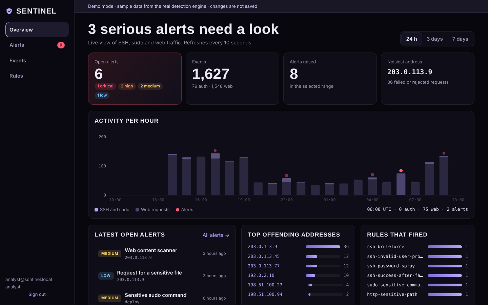
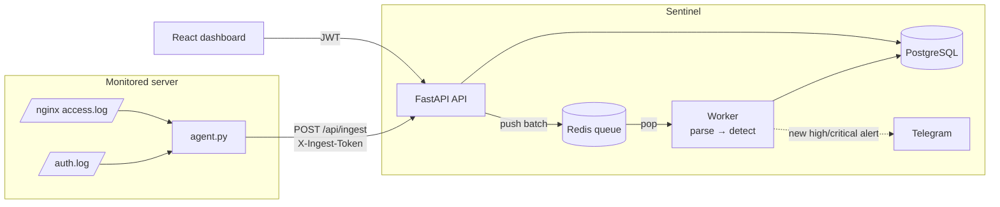

# Sentinel

**Self-hosted security monitoring for small servers.** A lightweight agent ships SSH, sudo and nginx logs to a FastAPI backend; a detection engine turns them into alerts that analysts triage from a React dashboard, with optional Telegram notifications.

**Live demo:** https://dav1dushka.github.io/sentinel/ (static build, sample data run through the real detection engine; any email signs you in)



## What it does

- **Collects logs:** a dependency-free Python agent follows `/var/log/auth.log` and nginx access logs, survives log rotation and retries with backoff when the API is down.
- **Detects attacks** with rules written in YAML: SSH brute force, password spraying, username probing, *a successful login right after failures*, risky `sudo` commands, web scanners, requests for `.env` / `.git`, and spikes of 5xx errors.
- **Manages alerts:** severity, evidence (the exact log lines), acknowledge / resolve / reopen, notes, assignee and a full audit history.
- **Explores events:** filter by source, type and IP, search raw lines, cursor pagination.
- **Notifies:** new high and critical alerts go to Telegram (optional).

| Alert with evidence and triage history | Events filtered by IP |
| --- | --- |
|  |  |

## Architecture



- **Ingestion is asynchronous.** The API only validates and queues a batch, so a flood of log lines never slows the dashboard down. One worker owns the detection state (sliding time windows), which keeps the results deterministic.
- **The detection core is pure Python** (`backend/sentinel/core/`): no I/O, no framework, no database. That makes it easy to unit-test and to replay old logs: time comes from the events, not the wall clock.
- **Alerts are grouped.** A rule that keeps firing for the same key updates the open alert instead of creating hundreds of new ones.

## Quick start (Docker)

```bash
git clone https://github.com/Dav1dushka/sentinel && cd sentinel
cp .env.example .env            # then change every value marked CHANGE ME
docker compose up --build
```

- Dashboard: http://localhost:8080, sign in with `SENTINEL_ADMIN_EMAIL` / `SENTINEL_ADMIN_PASSWORD` from `.env`
- API docs (OpenAPI): http://localhost:8000/docs
- The `seed` service loads a day of sample logs so the dashboard is not empty.

Want to watch it work live? Start the demo profile: a fake server writes normal traffic with an attack every minute, and a real agent ships it.

```bash
docker compose --profile demo up --build
```

## Monitor a real server

Copy `agent/agent.py` to the server (Python 3.9+, standard library only):

```bash
export SENTINEL_INGEST_TOKEN=...   # same value as in Sentinel's .env
sudo -E python3 agent.py --url https://sentinel.example.com \
     --file auth:/var/log/auth.log --file nginx:/var/log/nginx/access.log
```

## Detection rules

Rules live in [`backend/rules/default.yml`](backend/rules/default.yml), so changes are reviewed like code:

```yaml
- id: ssh-success-after-failures
  title: SSH login succeeded after failures
  severity: critical
  type: sequence
  match: {kind: ssh_failed}      # at least 3 of these…
  then: {kind: ssh_success}      # …followed by this, from the same IP
  group_by: ip
  threshold: 3
  window: 600                    # seconds
```

Conditions support equality, `in`, `regex`, `not` and numeric comparisons (`gt`, `gte`, `lt`, `lte`). `distinct: user` counts different values instead of events, which is how password spraying is caught. Invalid rules fail at startup with a message that names the rule.

## API

| Method | Path | Who | Purpose |
| --- | --- | --- | --- |
| POST | `/api/auth/login` | anyone | OAuth2 password form → JWT (rate-limited) |
| GET | `/api/auth/me` | user | current user |
| POST | `/api/ingest` | agent token | queue up to 5,000 log lines |
| GET | `/api/events` | user | filter by source, kind, ip, text; cursor pagination |
| GET | `/api/alerts` | user | filter by status, severity, text |
| GET / PATCH | `/api/alerts/{id}` | user | details; change status, add a note, assign to me |
| GET | `/api/stats/overview?hours=24` | user | counters, hourly timeline, top offenders, top rules |
| GET | `/api/rules` | user | loaded detection rules |
| GET / POST | `/api/users` | admin | list and create users |
| GET | `/api/health` | anyone | database, queue and rules status |

## Security decisions

- Passwords hashed with **scrypt** (salted, memory-hard), compared in constant time.
- Short-lived **JWT** access tokens with issuer, expiry and role checks; tokens with `alg: none` or unknown roles are rejected.
- **Roles:** analysts triage alerts, admins also manage users.
- **Login rate limiting:** 8 failed attempts per client per 5 minutes, then HTTP 429.
- Agents authenticate with a separate **ingest token**, compared in constant time; batches and line lengths are capped.
- The dashboard is served by nginx with a strict **Content-Security-Policy** and security headers; the API container runs as a non-root user.
- The app logs a warning when it starts with development secrets.

## Development

```bash
# backend
cd backend
python -m venv .venv && source .venv/bin/activate
pip install -r requirements-dev.txt
pytest -q                          # parsers, rules, engine, security and full API flow
uvicorn sentinel.main:app --reload # SQLite + inline processing, no Docker needed

# frontend (proxies /api to :8000)
cd frontend && npm install && npm run dev
npm run build:demo                 # static demo build with sample data
```

The sample logs are generated by `backend/samples/generate.py` (fixed seed, documentation-only IP ranges from RFC 5737). The tests check that each attack hidden in them produces exactly one alert and that normal traffic produces none.

CI (GitHub Actions) runs ruff and pytest, builds the dashboard and both Docker images; a second workflow publishes the demo to GitHub Pages.

## Project layout

```
agent/            log shipper and demo traffic generator (standard library only)
backend/
  sentinel/core/  parsers, rule loader, detection engine (pure Python)
  sentinel/       FastAPI app, models, pipeline, Redis worker, Telegram notifier
  rules/          detection rules (YAML)
  samples/        synthetic auth and nginx logs
  tests/          pytest suite
frontend/         React + TypeScript dashboard (Vite), SVG charts, demo mode
docker-compose.yml
```

## Roadmap

- Rule editor in the dashboard with a dry run against recent events
- More sources: journald, Windows Security log, Docker container logs
- GeoIP enrichment and an allow-list for known addresses
- Alembic migrations and per-host agent tokens

## License

MIT. Built by [Davyd Velychko](https://github.com/Dav1dushka).
